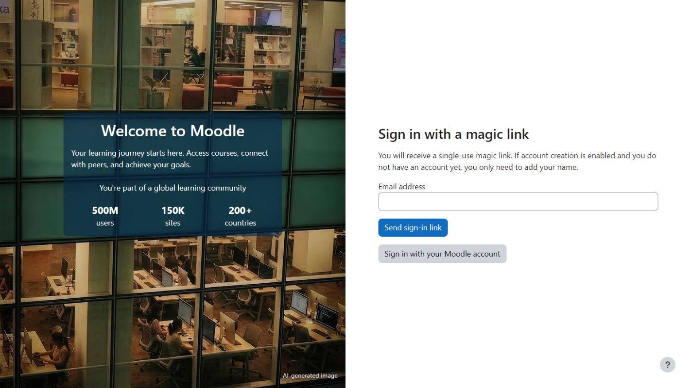
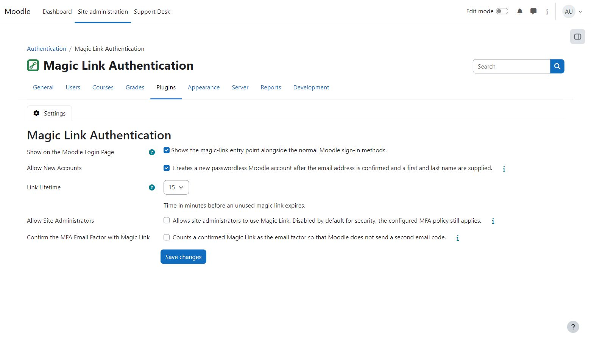

  

# Magic Link

`auth_magiclink` provides a general passwordless Moodle sign-in by email. When enabled, it adds a Magic Link entry to
Moodle's standard login page and preserves the destination the user originally requested.

Moodle routes additional authentication buttons through its identity-provider API. The plugin keeps that route as a
compatible fallback, but presents Magic Link in the browser as a separate “Sign in without a password” method. Real
OAuth, SAML or other external identity providers remain visibly separate.

Administrators can configure whether new verified-email accounts may be created, how long links remain valid, and whether
site administrators may use this method. Site-administrator links are disabled by default. Existing accounts retain their
current Moodle authentication method; using a Magic Link does not rewrite `user.auth`.

On the Settings page, the information icon in the Topnav user area opens **Magic Link Help** with general
guidance and detailed topics. Information popovers beside consequential settings provide short guidance
and link directly to the corresponding panel topic.

## Installation

Install as `auth/magiclink`, complete the Moodle upgrade, then enable Magic Link
under **Site administration > Plugins > Authentication > Manage authentication**.
Open its Settings page to configure sign-in and account creation. This distribution requires no license activation or 108design account.

## Moodle MFA

The optional **Confirm the MFA Email Factor with Magic Link** setting counts a successfully confirmed link as
Moodle's enabled email factor. This avoids a second email code. The configured factor weight, revocations,
lockouts and any remaining MFA requirements still apply. The option is off by default; Magic Link also works
without Moodle MFA. A link and a code sent to the same mailbox are not independent proofs of identity.

We recommend keeping **Allow Site Administrators** disabled, especially when using this single-email option.
Keep administrator sign-in protected with a password and an authenticator app or security key. Where Moodle's
trusted-device factor is enabled, link confirmation can offer the native configured trust duration; device trust
is saved only after the complete MFA policy succeeds.

## Screenshots

## Support

Report reproducible problems in the [issue tracker](https://github.com/108design/moodle-auth_magiclink-marketplace/issues).
Include your Moodle and PHP versions, the active theme, and the steps needed to reproduce the problem.
Remove personal data and sign-in links from reports.

## License

This is a 108design source-available commercial software license, not an open-source license. The Author retains ownership; Section 6a grants Moodle its Marketplace permissions. See [LICENSE.md](LICENSE.md) for the full terms.
